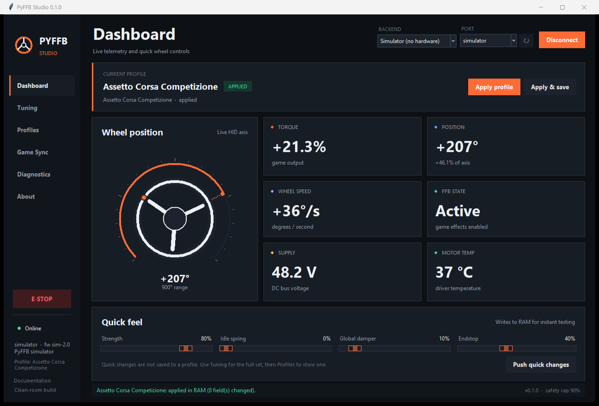

# PyFFB Studio

**A clean-room Python force-feedback wheel manager for sim racing.**

PyFFB Studio is an original Python application that covers the practical role of the EMC
utility layer: wheel tuning, effect shaping, steering configuration, profiles, game detection,
live telemetry and diagnostics. It targets [OpenFFBoard](https://github.com/Ultrawipf/OpenFFBoard),
an MIT-licensed open firmware that presents a standard USB HID force-feedback wheel to Windows
and Linux games.



> **Scope note**
>
> A Python process cannot safely be the real-time USB HID wheel. Games must see a hardware
> device, and force effects must be calculated at a deterministic rate. PyFFB therefore manages
> a standards-compliant wheel firmware; it does not inject into games, emulate a commercial
> wheel, replace a kernel driver or bypass any license. See
> [docs/ARCHITECTURE.md](docs/ARCHITECTURE.md) and [docs/CLEAN_ROOM.md](docs/CLEAN_ROOM.md).

---

## What works

- **OpenFFBoard backend** over USB CDC (pyserial), with identity probing, transactional writes,
  read-back, flash save, emergency stop and a raw command console.
- **No-hardware simulator** so the full interface and automation can be tested on any PC.
- **27 built-in profiles** for ACC, Assetto Corsa, iRacing, rFactor 2, Le Mans Ultimate,
  Automobilista 2, RaceRoom, EA F1, EA WRC, DiRT Rally 2.0, Richard Burns Rally, BeamNG,
  Forza Horizon 5, Forza Motorsport, Project CARS, truck sims, Wreckfest, GTR2, Race 07,
  NR2003, Dakar and more.
- **Automatic game switching** through executable basenames. The FFB values are applied when a
  game starts and the desktop profile is restored when it exits. Wheel range/invert changes are
  opt-in.
- **Safe updates**: app-side power cap, field-level validation, old-settings rollback if a write
  fails, and no writes to motor current, encoder, driver or brake-resistor settings.
- **Tuning UI** for strength, endstop, idle spring, global damper/friction/inertia, game effect
  ratio, spring/damper/friction/inertia gains, filters, speed limit, torque slew limit and expo.
- **Custom profiles** with import/export, executable mappings, desktop profile selection and
  per-profile notes.
- **Diagnostics**: live position/torque/speed/FFB/voltage/temperature, self-test, copyable report,
  rotating local log and a read-only raw query console.
- **CLI** for deployment, scripts, previews and headless auto-switching.

## Architecture at a glance

```text
┌────────────┐   standard HID PID effects   ┌─────────────────────┐
│ racing game│ ───────────────────────────▶ │ wheel firmware      │
└────────────┘                              │ (OpenFFBoard)       │
                                            │ 1 kHz FFB loop      │
                                            │ motor current limit │
                                            └──────────┬──────────┘
                                                       │ USB CDC
                                                       │ config + telemetry
                                            ┌──────────▼──────────┐
                                            │ PyFFB Studio        │
                                            │ profiles, tuning,   │
                                            │ game detection, UI  │
                                            └─────────────────────┘
```

PyFFB is **not** in the force-feedback loop. That is deliberate: game compatibility comes from
the firmware's HID descriptor and PID implementation; PyFFB changes how that wheel feels.

## Requirements

- Python 3.10+
- Windows 10/11 recommended (Tkinter ships with the official Python installer)
- A supported OpenFFBoard-compatible wheel for real hardware use
- A physical emergency stop / power switch for any high-torque wheel
- No hardware needed for the simulator

`pyserial` is required and is declared as a project dependency. `psutil` is optional and speeds
up automatic game detection; without it PyFFB falls back to `tasklist` on Windows and `ps` on
Unix.

## Quick start

### Windows

```powershell
cd E:\opencode\emc
.\install.ps1
.\run-simulator.bat
```

If PowerShell blocks local scripts, run:

```powershell
powershell -ExecutionPolicy Bypass -File .\install.ps1
```

Or manually:

```powershell
py -3 -m venv .venv
.\.venv\Scripts\Activate.ps1
python -m pip install -e ".[process]"
python -m pyffb gui --simulate
```

### Linux / macOS

```bash
python3 -m venv .venv
source .venv/bin/activate
python -m pip install -e ".[process]"
python -m pyffb gui --simulate
```

The simulator is the recommended first launch: it exercises the full UI, profile application,
telemetry and game detection without energising a motor.

## Connect a real wheel

1. Flash an OpenFFBoard-supported board with the **FFB Wheel (1 Axis)** main class. Use the
   official OpenFFBoard configurator for encoder, driver, current limits, voltage limits and
   brake resistor configuration.
2. Verify the wheel works as a standard game controller and that its hardware emergency stop
   removes motor power.
3. Connect the wheel's USB CDC port and close any other configurator holding the port open.
4. Start PyFFB:

   ```powershell
   python -m pyffb gui
   ```

5. Select **OpenFFBoard (USB CDC)**, choose the port, click **Connect**.
6. Confirm the reported position and FFB state, then apply the generic profile at low strength.
7. Tune, then use **Apply & save** only when the result is safe and repeatable.

Never use PyFFB to commission motor current, encoder alignment or driver timing. Those remain
in OpenFFBoard's own tools and are intentionally outside this app's write surface.

## CLI examples

```powershell
pyffb devices
pyffb info --port COM5
pyffb profiles list
pyffb apply --port COM5 --profile acc --dry-run
pyffb apply --port COM5 --profile acc
pyffb apply --port COM5 --profile acc --persist
pyffb watch --port COM5
pyffb simulate --seconds 3
pyffb doctor
```

Use `--backend simulator` on `apply` or `info` to run without hardware.

## Game compatibility

PyFFB's compatibility mechanism is the wheel firmware's **standard HID PID force feedback**. A
game that supports a DirectInput wheel and sends standard PID effects can drive the firmware
without any PyFFB involvement. PyFFB adds profile selection and automation on top.

That is broad, but no one can honestly promise *every* racing game:

- Titles that only accept a fixed list of commercial wheel USB IDs, require vendor software, or
  offer only gamepad rumble may not work without firmware-level identity work.
- Console-only and cloud titles are outside the desktop HID path.
- Some games automatically set wheel range and steering lock. Let the game do that, or enable
  automatic geometry only after confirming the interaction.
- Profiles here are **tuning starting points**, not physically validated per-game guarantees.
  Every car, tyre model, firmware build and motor changes the result.

The detailed matrix, per-game setup notes and caveats are in [docs/GAMES.md](docs/GAMES.md).

## Safety

This software can command a motor. Read [docs/SAFETY.md](docs/SAFETY.md) before connecting
hardware. Minimum requirements:

- Physical emergency stop / motor-power contactor independent of USB and Python.
- Correct fuse, wire gauge, grounding and strain relief.
- Firmware current limit configured before the first FFB test.
- Wheel securely mounted; hands and clothing clear of rotating parts.
- Test at low torque, with the wheel free to turn, before driving.

The app's `safety_max_power_pct` cap (default 90%) is an additional software guard, not a safety
device. Its emergency stop is best-effort software; the hardware switch is authoritative.

## Documentation

- [Installation and user guide](docs/USER_GUIDE.md)
- [Game profiles and compatibility](docs/GAMES.md)
- [Hardware and firmware setup](docs/HARDWARE.md)
- [Safety](docs/SAFETY.md)
- [Architecture and threading](docs/ARCHITECTURE.md)
- [OpenFFBoard command mapping](docs/PROTOCOL.md)
- [Public-behavior analysis of the EMC category](docs/EMC_ANALYSIS.md)
- [Clean-room provenance and scope](docs/CLEAN_ROOM.md)
- [Python API](docs/API.md)
- [Testing](docs/TESTING.md)
- [Roadmap](docs/ROADMAP.md)
- [Documentation index](docs/INDEX.md)

## Development

```bash
python -m pip install -e ".[dev]"
python -m pytest -q
python -m ruff check pyffb tests
PYFFB_GUI_TEST=1 python -m pytest tests/test_gui.py -q
```

On Windows PowerShell:

```powershell
$env:PYFFB_GUI_TEST = "1"
python -m pytest tests/test_gui.py -q
```

## Project layout

```text
pyffb/
  backends/       OpenFFBoard serial transport + simulator
  gui/            Tkinter app, theme, widgets and views
  cli.py          argparse CLI
  config.py       app config, profile library, atomic JSON
  controller.py   safety policy and transactional apply
  gamewatch.py    process detection and switch state machine
  models.py       typed settings/profile/telemetry models
  presets.py      built-in game profiles
  protocol.py     command grammar and scaling
docs/             user, hardware, protocol, safety and API docs
examples/         API demo and profile template
tests/            protocol, model, controller, CLI and GUI tests
```

## Provenance and license

PyFFB Studio is an independent clean-room project. It contains no EMC firmware, decompiled
code, private protocol, activation bypass or redistributed EMC binaries. Public interoperability
information came from the USB HID PID specification and OpenFFBoard's MIT-licensed documentation
and source.

PyFFB Studio is released under the MIT License. OpenFFBoard, Python, Tkinter and pyserial retain
their own licenses. EMC is a third-party product name used only for identification; this project
is not affiliated with or endorsed by its author.

## Status

**0.1.0 / beta.** The simulator, models and profile engine are covered by automated tests. Real
hardware behavior depends on the OpenFFBoard firmware version and the physical build. Start with
the simulator and a low-torque hardware acceptance test before trusting any profile.
