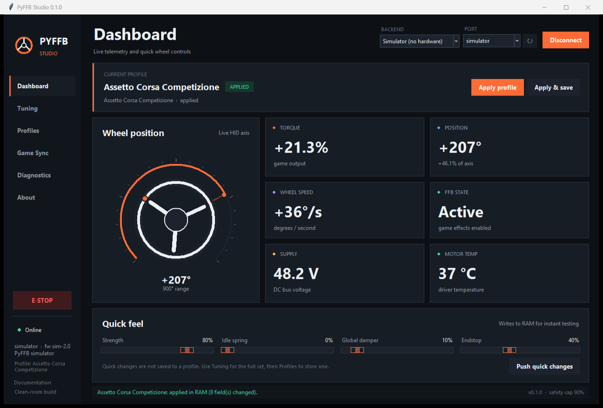
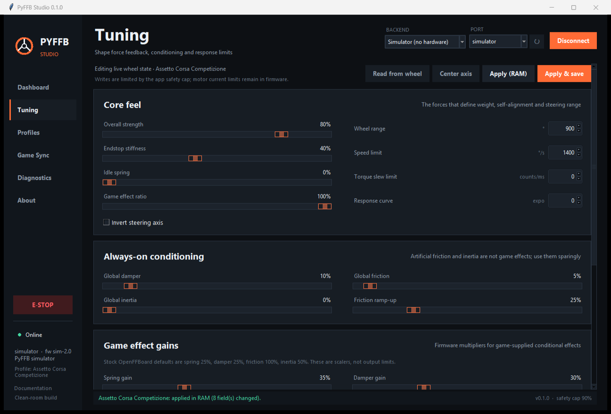

# Installation and user guide



## 1. Install

### Windows with the helper script

Requirements: Python 3.10+ with Tcl/Tk (the standard python.org installer includes it).

```powershell
cd E:\opencode\emc
.\install.ps1
```

This creates `.venv`, installs the package and optional process-detection extra, and leaves the
environment ready.

Start the simulator:

```powershell
.\run-simulator.bat
```

Start for hardware:

```powershell
.\run.bat
```

### Manual install

```powershell
py -3 -m venv .venv
.\.venv\Scripts\Activate.ps1
python -m pip install -e ".[process]"
python -m pyffb gui --simulate
```

### Linux / macOS

```bash
python3 -m venv .venv
source .venv/bin/activate
python -m pip install -e ".[process]"
python -m pyffb gui --simulate
```

On Linux, ensure your user can access the serial device (usually `dialout`).

## 2. First launch: use the simulator

The simulator requires no wheel. It provides:

- synthetic position, speed, torque, voltage and temperature;
- profile application and safety-cap behavior;
- all views, diagnostics and game detection;
- a safe way to learn the UI.

Click **Connect** with **Simulator (no hardware)** selected. Then:

1. Open **Dashboard** and watch the gauge and metrics move.
2. Open **Tuning**, change a value, click **Apply (RAM)**.
3. Open **Profiles**, select **Assetto Corsa Competizione**, click **Apply**.
4. Open **Game Sync** to see automation options and executable mappings.
5. Open **Diagnostics**, run the self-test and try a read-only command.

Exit the app when done. The simulator does not touch a motor.

## 3. Connect real hardware

Before starting, read [SAFETY.md](SAFETY.md) and [HARDWARE.md](HARDWARE.md).

1. Power the motor supply and wheel controller according to the hardware instructions.
2. Connect USB.
3. Verify the wheel is visible in Windows game controllers and force feedback works.
4. Close any other configurator using the COM port.
5. Start PyFFB and choose **OpenFFBoard (USB CDC)**.
6. Click the refresh (`↻`) button if the port list is empty.
7. Select the port and click **Connect**.
8. Confirm the status shows **Online**, identity appears in Diagnostics, and telemetry is
   plausible.
9. Start at low strength and apply a profile only after confirming the hardware E-stop.

If the port probe fails, PyFFB closes the port. It does not write to a device that did not identify
as OpenFFBoard.

## 4. Window layout

### Sidebar

- **Dashboard** — live gauge, metrics and quick controls.
- **Tuning** — complete FFB parameter editor.
- **Profiles** — built-ins, custom profiles, import/export, desktop profile.
- **Game Sync** — automatic switching and executable mappings.
- **Diagnostics** — device identity, read-only commands, self-test and log.
- **About** — scope, clean-room provenance and documentation links.
- Bottom status shows online/offline and the active profile.

### Top bar

- **Backend** — OpenFFBoard or simulator.
- **Port** — serial port; refresh button rescans.
- **Connect / Disconnect** — opens or closes the device session.

### Sidebar emergency stop

The red **E-STOP** button sits above the connection status in the sidebar so it stays reachable
even when other views scroll. It is a best-effort software stop; the hardware switch remains
mandatory.

### Status bar

Reports success, warnings, errors and the safety cap. Messages clear after a few seconds.

## 5. Dashboard

**Current profile** shows the selection and whether it is applied.

- **Apply profile** writes changed values to RAM.
- **Apply & save** writes to RAM and executes `sys.save`.
- **Preview** means no wheel is connected; the values are shown but cannot be written.

**Wheel position** is a vector gauge driven by `axis.0.curpos`. It shows normalised motion and
approximate degrees based on the current range.

**Metrics:**

| Metric | Meaning |
|---|---|
| Torque | Signed normalised output from the firmware; clipping is highlighted |
| Position | Wheel axis position as degrees and percentage |
| Wheel speed | Firmware-reported deg/s |
| FFB state | Whether the game firmware currently considers FFB active |
| Supply | DC bus voltage |
| Motor temp | Firmware-reported temperature; not a substitute for a thermal sensor |

**Quick feel** has strength, idle spring, global damper and endstop. It writes only those fields
when you click **Push quick changes**. It does not update the stored profile.

## 6. Tuning



The Tuning view is the main editor. **Read from wheel** pulls the current device values. **Apply
(RAM)** writes differences without flash. **Apply & save** persists to firmware storage. **Center
axis** sets the current physical position as 0° after confirmation.

### Parameter reference

| Parameter | Range | Effect |
|---|---|---|
| Overall strength | 0–100% | Maps to firmware torque scaler. Primary authority. |
| Wheel range | 90–2520° | Firmware axis range; games may also set range. |
| Endstop stiffness | 0–100% | Soft endstop force. Keep conservative on high-torque builds. |
| Idle spring | 0–100% | Centring when no game FFB is active. |
| Global damper | 0–100% | Always-on resistance proportional to speed. |
| Global friction | 0–100% | Always-on friction; useful for weight, risky if overdone. |
| Global inertia | 0–100% | Always-on resistance proportional to acceleration. |
| Game effect ratio | 0–100% | Scales game PID effects; endstop is excluded by firmware. |
| Speed limit | 0–3600°/s | Firmware speed limiter; 0 disables. |
| Torque slew limit | counts/ms | Limits how quickly torque changes; 0 disables. |
| Response curve | -127..127 | Firmware expo curve. 0 is linear. |
| Spring gain | 0–100% | Multiplier for game spring effects. |
| Damper gain | 0–100% | Multiplier for game damper effects. |
| Friction gain | 0–100% | Multiplier for game friction effects. |
| Inertia gain | 0–100% | Multiplier for game inertia effects. |
| Friction ramp-up | 0–100% | Speed range over which friction ramps in. |
| Constant filter frequency | 1–500 Hz | Low-pass on constant force. |
| Constant filter Q | 1–127 | Q × 0.01; default 70 = 0.70. |
| Custom condition filters | on/off | Switches OpenFFBoard to custom biquad profile 1. |
| Condition filter fields | 1–500 Hz / 1–127 | Per-effect low-pass tuning. |

The firmware gain fields are **not** normalised output levels. Stock OpenFFBoard defaults are
roughly 25% spring, 25% damper, 100% friction and 50% inertia. Raising them all to 100% can make a
wheel violently strong.

### Suggested tuning order

1. Set in-game FFB gain and wheel range first.
2. Set PyFFB **Overall strength**.
3. Add **Endstop** and **Idle spring**.
4. Tune condition-effect **gains**.
5. Add global damper/friction only to solve a specific problem.
6. Add filters last.

Change one field at a time. Keep notes in a custom profile.

### Applying and saving

- **Apply (RAM)** survives until the wheel reboots or another save overwrites flash.
- **Apply & save** writes `sys.save`.
- Game auto-switching defaults to RAM. Enabling auto-persist causes a flash write at every game
  start/exit and is not recommended.
- A failed apply is rolled back to the last read settings when possible. If rollback fails, the
  app tells you to power-cycle.

## 7. Profiles

The left list shows built-in and custom profiles. Search filters by name, game, id or executable.

Selecting a profile shows:

- game and executable mapping;
- settings summary;
- notes and in-game suggestions;
- badges for applied, custom and desktop status.

Buttons:

- **Apply** — RAM only.
- **Apply & save** — persist to wheel.
- **Duplicate…** — create an editable custom copy, including executable mapping.
- **Set desktop** — profile applied when a game exits (when auto-switching is on).
- **Export…** — JSON file.
- **Update with current tuning** — custom profiles only; replace stored settings with the live
  wheel state.
- **Edit metadata…** — custom profiles only; name, game, executables, description, notes.
- **Delete** — custom profiles only. The desktop profile cannot be deleted.

`Create from current…` creates a custom profile from the live settings. Add an executable basename
to opt in to auto-switching.

### Profile JSON

Profiles are portable JSON. See [examples/custom_profile.json](../examples/custom_profile.json).
A minimal file:

```json
{
  "id": "custom-my-game",
  "name": "My Game",
  "game": "My Game",
  "exe_names": ["mygame.exe"],
  "settings": {
    "power_pct": 65,
    "rotation_deg": 900
  }
}
```

Missing settings use defaults. Imported profiles are always treated as custom and cannot overwrite
built-in IDs.

## 8. Game Sync

Options:

- **Enable automatic profile switching** — detect games every two seconds and apply mappings.
- **Also apply wheel range / invert** — off by default. Turn on only if you want the app to change
  geometry. Some games set their own range.
- **Persist auto changes to flash** — off by default; avoid flash wear.

How switching behaves:

- Game starts → matching profile applied (FFB settings; geometry only if enabled).
- Game switches → new profile applied.
- Game exits → desktop profile applied.
- Same running game → no repeated writes.
- Manual profile changes are not constantly overridden; the session only changes on start/switch/
  exit.

If a game update renames its executable, auto-switching will not fire. Duplicate the profile and
edit the executable in metadata. The mapping is an exact, case-insensitive basename match, not a
window title.

## 9. Diagnostics

- **Device** — connection, backend, port, firmware, hardware, active profile.
- **Run self-test** — read-only settings/telemetry check; prints PASS or failure detail.
- **Copy report** — copies device/config/telemetry information for support.
- **Log folder** — opens the local application data directory.
- **Raw read-only command** — queries such as `axis.0.power?`, `main.0.ffbactive?`,
  `axis.0.curpos?`. Writes, execute commands and side-effecting GETs (reboot/DFU/flash/format)
  are blocked; use Tuning and the dedicated Center axis action.
- **Log** — rotating log of connection, apply and error events.

## 10. CLI

```text
pyffb gui [--simulate] [--profile ID]
pyffb devices [--backend openffboard|simulator]
pyffb info --port COM5 [--json]
pyffb apply --port COM5 --profile acc [--persist] [--no-rotation] [--dry-run]
pyffb profiles list [--json] [--grep TEXT]
pyffb profiles show ID
pyffb profiles export ID FILE.json
pyffb profiles import FILE.json
pyffb profiles delete ID
pyffb watch --port COM5 [--interval 2]
pyffb simulate [--seconds N] [--profile ID]
pyffb doctor
pyffb config path|show|reset --yes
```

Global options: `--config-dir`, `--verbose`, `--version`.

Use `--backend simulator` wherever a port is accepted to test without hardware.

## 11. Configuration and logs

Default Windows location:

```text
%APPDATA%\PyFFB\
  config.json
  logs\pyffb.log
```

Override with `--config-dir PATH` or the `PYFFB_CONFIG_DIR` environment variable.

`config.json` stores backend, last port, automation settings, safety cap, window geometry and
custom profiles. It is written atomically. A malformed file is backed up with a timestamp and
defaults are loaded.

Back up the whole folder to preserve custom profiles. Individual profiles can also be exported as
JSON.

## 12. Troubleshooting

| Problem | Action |
|---|---|
| App does not start | Run `python -m pyffb doctor`; verify Python/Tkinter; see console traceback |
| No serial ports | Install pyserial, use a data USB cable, check device manager, close other tools |
| "Connect" timeouts | Select the CDC port, flash FFB Wheel firmware, close configurator, check main class |
| Port opens but no identity | Wrong port or firmware; PyFFB closes it rather than writing blindly |
| FFB feels weak | Check firmware current limit, PSU sag, in-game gain, app strength and effect gains |
| FFB feels too strong | Lower app strength and gains; verify in-game gain; use the hardware stop |
| Oscillation | Lower strength/spring, add damper, verify encoder/mechanical play, inspect game FFB |
| Game does not see wheel | Test in Windows game controllers; use a title with DirectInput wheel support |
| Auto-switch does not fire | Exact executable name, automation enabled, game on same PC, refresh profile metadata |
| Profile apply error | Read log; possible firmware command mismatch or USB disconnect; power-cycle if told |
| Game exits but desktop profile not applied | Connection lost or automation disabled; check Game Sync |
| UI freezes during device op | Serial timeouts can block one worker; wait, then inspect logs |
| Custom profile disappeared | Check config backup or re-import exported JSON |

Run `pyffb doctor` and include its output plus the relevant log excerpt when requesting help.

## 13. Update and uninstall

Update:

```bash
git pull
python -m pip install -e ".[process]"
```

Uninstall the package:

```bash
python -m pip uninstall pyffb-studio
```

Remove `%APPDATA%\PyFFB` only if you do not want to keep settings and profiles. The wheel's saved
settings remain in its firmware until overwritten.

## 14. FAQ

**Does PyFFB make my wheel work with every game?**
It helps with any game that supports a standard DirectInput FFB wheel. The firmware's HID device is
what the game sees. Games with proprietary wheel requirements may not work.

**Can I close PyFFB while racing?**
Yes. Game FFB goes directly to the firmware. Profiles are already in wheel RAM/flash; automatic
switching stops when the app closes.

**Does auto-switching modify flash?**
No by default. Enable **Apply & save** or auto-persist if you want persistence; that wears flash.

**Why can't I edit motor current here?**
Wrong motor/current/encoder settings can destroy hardware or hurt you. Use OpenFFBoard's
configurator and follow its commissioning procedure.

**Can I use EMC firmware with this?**
No. EMC hardware/protocol is not supported. See [CLEAN_ROOM.md](CLEAN_ROOM.md).

**Why does raw console reject `sys.save`?**
It is deliberately read-only so it cannot bypass validation and the power cap. Use the Save button.

**Where do I report a bug?**
Use the project issue tracker or [SECURITY.md](../SECURITY.md) for safety-sensitive reports.
Include `pyffb doctor`, logs, firmware version and hardware details.
